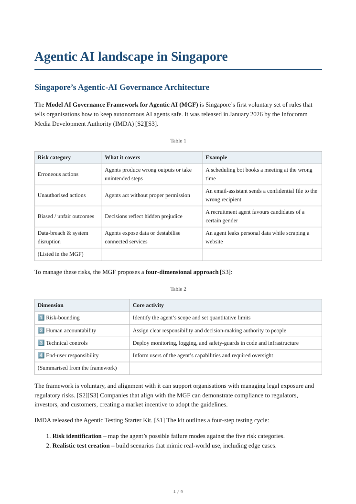
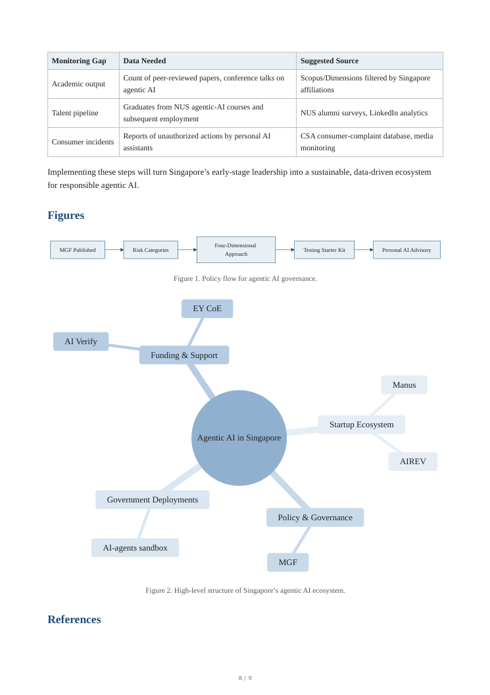

# Multi-Agent Research Assistant (v2)

A multi-agent research assistant built on [CrewAI](https://www.crewai.com/). Give it a topic and it decides how deeply the topic needs researching, searches the web and scholarly databases, reads the most relevant pages and open-access papers, and writes a report in which every claim cites a source it actually retrieved. Before the report is finished, a claim check compares each cited statement with the text of its sources and rewords or removes what they do not support. You get Markdown, and optionally a styled PDF with tables, charts from real data, and diagrams.

It runs from a Streamlit app or the command line. A typical medium report takes 2 to 3 minutes and costs a few US cents in model usage through OpenRouter.

> **About v1.** This is version 2. [Version 1](https://github.com/nepseli/multi-agent-research-assistant) is a much simpler CrewAI project: three agents (researcher, analyst, writer) run in a fixed order with one web-search tool and write a Markdown report. The link is here only for reference, for anyone curious how the project started. **You do not need v1 to use or understand v2**: this repository is complete on its own.
>
> **The main difference is the architecture.** v1 is a **CrewAI Crew pipeline**: one `Crew` runs its three tasks in a fixed sequence, each task's output feeding the next, and the agents decide everything in between. v2 is built on a **[CrewAI Flow](https://docs.crewai.com/en/concepts/flows)**: the run is a set of Python stages (route, research, analyse, figures, write, render) linked with `@start` and `@listen`. Small crews do the agent work inside the research, routing and analysis stages, while plain code between the stages controls the rest: budgets, which tools each tier gets, what happens when the worker is down, citation checks, the claim check, figures and PDF output. That is what makes v2's behaviour predictable and testable without models.
>
> What v2 adds over v1: depth tiers set by a router; budgets enforced in code; page reading and open-access PDF parsing through a Docker worker; scholarly search (OpenAlex, Semantic Scholar, Crossref, arXiv, Unpaywall); a source registry so citations cannot be invented; a claim check against source text; size-controlled writing; PDF output with charts and checked diagrams; strong and light model tiers; a setup check; and a test suite that needs no API keys.

**See what you get:** a [sample report (PDF)](docs/sample/agentic-ai-singapore.pdf), also as [Markdown](docs/sample/agentic-ai-singapore.md). It is a medium, Tier 1 report on "Agentic AI landscape in Singapore", made in about 2.5 minutes for roughly US$0.04 of model usage.

<p>
  
  
</p>

## How it works

`flows/research_flow.py` is a CrewAI Flow, not a single Crew pipeline as in v1. Each stage is a method that runs when the previous one finishes, and the agents and model calls it needs are passed in through `FlowDeps`, so tests swap them for fakes. The stages are:

1. **Route.** A router agent classifies the topic and picks a depth tier. Code, not the model, sets the budgets.
2. **Research.** A research agent uses only the tools the tier allows, within its search, page and PDF budgets.
3. **Analyse.** An analyst agent finds patterns and conclusions.
4. **Figures** (PDF only). Charts are drawn only from real data files (OpenAlex publication counts, tables parsed from papers); chart specs without data are rejected. Mermaid diagrams (flowchart, timeline, mindmap) are held to size limits that keep them readable on an A4 page, then drawn by the worker to catch syntax errors and drawings too wide or tall for a page. A rejected diagram gets one repair attempt with the reason, and is left out (with a coverage note) if it still fails. Each diagram's source and outcome is saved to `runs/<id>/diagrams.json`.
5. **Write.** The writer plans 5-7 sections (8-12 for big), writes them in parallel to word targets, and checks the length. A **claim check** then compares every cited statement with the saved text of its sources: statements their sources do not support are reworded or removed, and the result is summarised in the coverage notes and saved to `runs/<id>/claims.json`. Statements that rest only on search snippets are left in but reported as unverified, because a snippet is too short to prove them wrong. If the sources support too little and the report comes out under its target length, the report says so at the top, with how many of the sources found back its statements (for example "only 2 of 35").
6. **Render** (PDF only). The Docker worker turns styled HTML into a PDF. If rendering fails you still get the Markdown report and a coverage note.

Every source is stored in a registry. The writer cites sources as `[S1]`, `[S2]`; unknown ids are stripped and the reference list is generated by code, so the report cannot cite something that was not retrieved. Each reference says how deeply it was read: in full, abstract only, or search snippet only.

Every report opens with a short **How this report was made** box, built from the run's own records: the date, depth tier, searches run, pages and papers read in full, sources found and cited, the claim check result and the models used. In the PDF, each `[S#]` links to its reference, and each figure sits after the section it illustrates (figures that match no section go at the end).

### Depth tiers

| Tier | For | Searches | Pages | PDFs | Time cap |
|------|-----|----------|-------|------|----------|
| 0 | weather, recipes, quick facts | 2 | 0 | 0 | 60 s |
| 1 | general topics | 5 | 8 | 0 | 180 s |
| 2 | technical and scientific topics (adds OpenAlex, arXiv, Crossref, Semantic Scholar, Unpaywall) | 8 | 15 | 5 | 420 s |
| 3 | deep literature review (adds Firecrawl fallback if a key is set, gap check) | 15 | 30 | 10 | 900 s |

Choose **Auto** to let the router decide, or force a tier. PDF output and the Big size raise a Tier 0 request to Tier 1, and budgets are scaled up (never beyond 1.5 times the Tier 3 caps).

### Report sizes

| Size | Words | Approx. PDF pages | Tables | Figures |
|------|-------|-------------------|--------|---------|
| Small | 800–1,200 | 2–4 | 1 | 1–2 |
| Medium (default) | 2,000–3,000 | 6–10 | 2 | 3–4 |
| Big | 5,000–7,000 | 14–23 | 4 | 6–8 |

## Built with

| Part | Tools |
|---|---|
| Agents and orchestration | [CrewAI](https://www.crewai.com/) Flow (stages) and Crews (router, research and analyst agents with tools) |
| Models | [OpenRouter](https://openrouter.ai/): `gpt-oss-120b` for judgement-heavy steps, `gpt-oss-20b` for short constrained ones; any OpenRouter or LiteLLM model can be swapped in |
| Web search | [Serper](https://serper.dev/) (Google results API) |
| Scholarly search | [OpenAlex](https://openalex.org/), [Semantic Scholar](https://www.semanticscholar.org/product/api), [Crossref](https://www.crossref.org/documentation/retrieve-metadata/rest-api/), [arXiv](https://info.arxiv.org/help/api/index.html), [Unpaywall](https://unpaywall.org/products/api) for open-access copies |
| Reading pages | [Crawl4AI](https://github.com/unclecode/crawl4ai) with headless Chromium, in the Docker worker; [Firecrawl](https://www.firecrawl.dev/) as an optional Tier 3 fallback |
| Reading papers | [Docling](https://github.com/docling-project/docling) (PDF to Markdown and tables), in the full worker image |
| Charts and diagrams | [matplotlib](https://matplotlib.org/) (charts from real CSV data), [Mermaid](https://mermaid.js.org/) (flowcharts, timelines, mindmaps, checked in the worker) |
| PDF output | [Python-Markdown](https://python-markdown.github.io/) and [Jinja2](https://jinja.palletsprojects.com/) build styled HTML; [Playwright](https://playwright.dev/python/) Chromium prints it to PDF in the worker |
| Worker service | [FastAPI](https://fastapi.tiangolo.com/) and Uvicorn in [Docker](https://www.docker.com/) (bound to localhost) |
| App | [Streamlit](https://streamlit.io/) (including its PDF viewer) |
| Plumbing | [uv](https://docs.astral.sh/uv/), [Pydantic](https://docs.pydantic.dev/), [httpx](https://www.python-httpx.org/), python-dotenv |
| Tests | [pytest](https://docs.pytest.org/) and [respx](https://lundberg.github.io/respx/), with fakes for models and the worker |

## Project structure

```text
.
├── app.py / app_helpers.py   # Streamlit UI and its testable helpers
├── main.py                   # CLI
├── flows/research_flow.py    # The Flow: route → research → analyse → figures → write → render
├── crews/factories.py        # Router, research and analyst crews, built per run
├── core/                     # config, models, plan budgets, source registry, run folders
├── tools/                    # academic APIs, research tools, worker client, setup check
├── report/                   # writer, validators, figures, charts, diagrams, PDF
├── worker/                   # Docker worker: Crawl4AI, Docling, Playwright PDF rendering
├── docs/sample/              # sample report and the previews shown above
├── docker-compose.yml
└── tests/
```

Each run writes to `runs/<topic>-<timestamp>/`: `plan.json`, `findings.md`, `analysis.md`, `sources.json`, `sources/`, `data/`, `figures/`, `log.jsonl`, `claims.json`, `diagrams.json`, `usage.json` (seconds per stage, tokens per model and a cost upper bound), `<topic>-report.md` and `<topic>-report.pdf` (named after your topic).

## Quick start

You need [uv](https://docs.astral.sh/uv/), an [OpenRouter API key](https://openrouter.ai/settings/keys) and a [Serper API key](https://serper.dev/) (Serper gives free search credits on sign-up). Docker is optional but needed to read web pages and papers and to produce the PDF.

1. Install and add your keys:

   ```bash
   uv sync                     # Windows inside OneDrive: set UV_LINK_MODE=copy first
   cp .env.example .env        # PowerShell: Copy-Item .env.example .env
   ```

   Then put `OPENROUTER_API_KEY` and `SERPER_API_KEY` in `.env`.

2. Check the setup. This validates both keys, every configured model ID, that the price caps leave a host for each model, your Serper balance and the worker. It costs nothing; add `--live` to also send one tiny prompt to each model.

   ```bash
   uv run python main.py --check
   ```

3. Start the worker (optional). Pick one image:

   | Image | Command | Size | What it adds |
   |---|---|---|---|
   | Full | `docker compose up -d --build` | ~6.2 GB, first build ~6-10 min | Reads web pages, parses open-access PDFs (Docling), draws diagrams, renders the PDF |
   | Lean | `WORKER_DOCLING=0 docker compose up -d --build` (PowerShell: `$env:WORKER_DOCLING = "0"` first) | ~3.2 GB, first build ~4 min | Everything except parsing PDFs; papers fall back to their abstracts |

   Without any worker, reports still work from search snippets and abstracts and say so in their coverage notes.

4. Run the app:

   ```bash
   uv run streamlit run app.py
   ```

Command line:

```bash
uv run python main.py --topic "GaN power device defects" --size medium --pdf --tier 2
```

While a run is going, the app shows the stage, the elapsed time and what the research agent is doing ("Read page 3 of 8: imda.gov.sg"). When it finishes, it shows the time, model calls, tokens and the most the run can have cost. The cost is an upper bound: CrewAI reports tokens, not prices, so tokens are priced at the cap each model was routed under (or its dearest host). Past reports can be reopened from **Past runs** in the sidebar, and PDF reports open inline in a **PDF** tab.

The **Stop** button cancels a run. It takes effect between stages, once the model call in progress finishes, and partial work stays in the run folder.

## Configuration

`.env.example` lists every variable. Models come in two tiers, so you normally set just two:

| Setting | Default | Used by |
|---------|---------|---------|
| `STRONG_LLM` | `openrouter/openai/gpt-oss-120b` | router (triage), research agent, analyst, writer (report sections) |
| `LIGHT_LLM` | `openrouter/openai/gpt-oss-20b` | editor (outline, length adjustment, citation repair), figure and diagram planner, fact checker (claim check) |

Any role can be pinned to its own model with `ROUTER_AGENT_LLM`, `RESEARCH_AGENT_LLM`, `ANALYST_AGENT_LLM`, `WRITER_AGENT_LLM`, `EDITOR_LLM`, `FIGURE_PLANNER_LLM` or `FACT_CHECKER_LLM`. Temperatures are optional (`*_TEMP`). For PDF reports only, `STRONG_LLM_PDF` / `LIGHT_LLM_PDF` or a role's `*_LLM_PDF` take precedence; `openrouter/openai/gpt-5` is a valid OpenRouter ID. The Streamlit sidebar shows which model each step will use.

**Speed settings.** These are all optional; the defaults are shown.

| Variable | Default | Effect |
|---|---|---|
| `OPENROUTER_SORT` | `throughput` | Ask OpenRouter for its fastest host of the model. `default` keeps OpenRouter's own price-weighted choice. |
| `STRONG_MAX_PRICE` / `LIGHT_MAX_PRICE` | `0.15,0.60` / `0.075,0.30` | Highest price allowed when choosing a host, in USD per million tokens (input,output). The defaults are Groq's prices, so the dearest hosts are skipped. Applies only to `STRONG_LLM` / `LIGHT_LLM`, not to role or PDF overrides. `none` removes the cap. |
| `STRONG_REASONING` / `LIGHT_REASONING` | model default / `low` | How hard gpt-oss thinks before answering (`low`, `medium` or `high`). `default` sends nothing. |
| `<ROLE>_REASONING` (e.g. `FIGURE_PLANNER_REASONING`) | `medium` for the figure planner | Per-role override; beats the tier setting. The figure planner and fact checker default to `medium`: diagram syntax breaks and claim judgements get careless at `low`. |
| `CLAIM_CHECK` | `on` | `off` skips the claim check (saves about 10 s and a few light-model calls). |
| `WRITER_PARALLELISM` | `4` | How many report sections are written at once. `1` writes them one after another. |

## Tests

```bash
uv run pytest -q
```

The suite uses fakes for the models and the worker, so it needs no API keys or Docker.

## Known limits

- The Docker worker is built and smoke-tested. Docling runs on CPU at about 1.5 s per PDF page, so Tier 2 and 3 runs that read many PDFs spend much of their time limit parsing.
- The Tier 3 gap check is an instruction to the research agent, not enforced code.
- Live model behaviour (router quality, research crews) depends on the models you configure.
